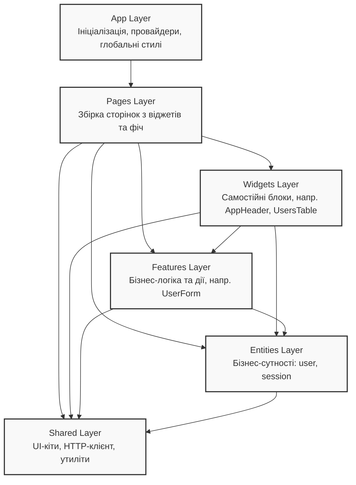

## Архітектура проєкту (Feature-Sliced Design)

Проєкт побудовано за методологією **Feature-Sliced Design (FSD)**. Стрілками показано напрямок залежностей (нижні шари не можуть імпортувати верхні).

